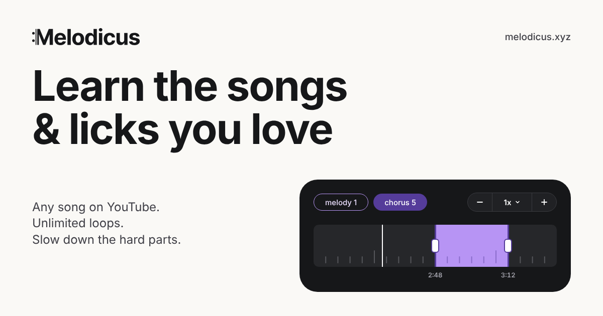
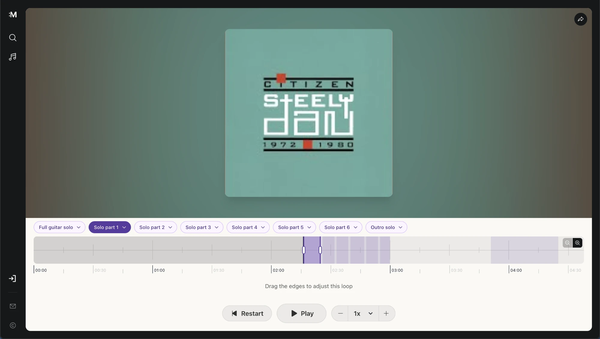

[](https://melodicus.xyz)

Practice any song on YouTube: loop the hard parts and slow them down until they stick. **Try it at [melodicus.xyz](https://melodicus.xyz).**



## Why

Melodicus opens any YouTube video in a player built for learning melodies, solos and licks. YouTube has looping and slower playback too, but they're tucked away in menus and slow to use over and over. Here they're right in front of you.

The heart of it is the loop: pick out a part of a song, name it, and play it back as many times as it takes. Musicians, teachers and students can break a song into parts, learn each one at their own speed, then play the whole thing through.

I designed Melodicus for the way I transcribe: an iPad on a music stand, a guitar in my hands. The controls are easy to use on a touch screen and readable from a couple of feet away. I hope others find it useful too.

## Features

- **Any song on YouTube:** search by title and artist, or paste a link.
- **Unlimited loops:** drag across the timeline to mark a part, name it, and come back to it.
- **0.25x to 2x:** slow a part down without changing its pitch, then speed it back up.
- **Share your songs:** a link brings the loops with it, so a teacher or bandmate gets the same parts.
- **No account needed:** everything works right away, saved in your browser. Log in with a code sent to your email to keep your songs on any device.
- **Built for practice:** big, touch-friendly controls that work on a phone, a tablet or a computer.

## Development

Requires Node 22.12 or newer.

```bash
cp .env.example .env.local   # then fill in what it lists
npm install
npm run dev                  # http://localhost:3000
```

Other scripts: `npm test` (Vitest, watch mode), `npm run test:e2e` (Playwright), `npm run lint`, `npm run typecheck`, `npm run build`, `npm run preview`.

Built with React, TypeScript, Vite, Chakra UI, TanStack Query, Supabase and wavesurfer.js, and hosted on Vercel.

### Where things live

| Folder | What's in it |
| --- | --- |
| `src/` | The app |
| `api/` | Vercel functions: the YouTube search and video proxy, which keeps the API key on the server, and the daily Supabase keep-alive |
| `supabase/` | Database migrations, and the login email templates with their setup steps (`supabase/templates/README.md`) |
| `scripts/` | Generators for the social card and the app icons |
| `e2e/` | Playwright tests |

## Deployment

Vercel deploys `main` to [melodicus.xyz](https://melodicus.xyz), and builds a preview for each pull request.

Supabase pauses free projects after about a week without activity, so a Vercel cron job calls `api/keep-alive` daily, with a GitHub Action (`.github/workflows/keep-alive.yml`) as a backup.

## Database

The Supabase schema lives in `supabase/migrations/`. Production predates the migrations, so apply new ones by running their SQL in the Supabase SQL Editor. After a schema change, regenerate the TypeScript types with `npm run db:types` (requires `npx supabase login`).

## Contact

Questions, bugs or ideas: email [support@melodicus.xyz](mailto:support@melodicus.xyz), or open an issue here on GitHub.

## License

The source is public to read, but it isn't open source: all rights reserved.
